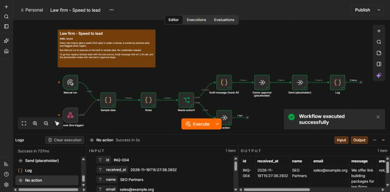

# Law firm - Speed to lead

**Demo business:** Harlow & Reed Law (fictional)
**What the business buys:** Speed

Every new inquiry gets a useful first reply in under a minute, is sorted by practice area and flagged when urgent.

**What it replaces:** The inquiry that sat in the inbox until Monday while the client called another firm.



## Flow

```mermaid
flowchart LR
  T[Webhook (new record arrives)] --> S[Sample data]
  M[Manual run] --> S
  S --> R[Rules]
  R --> Q{Needs action?}
  Q -- yes --> D[Draft message] --> A[Owner approval] --> X[Send] --> L[Log]
  Q -- no --> N[No action]
```

## Sample run

4 sample records: 3 produce a draft, 1 are skipped.

| Record | Result |
|---|---|
| INQ-001 | draft: new client inquiry |
| INQ-002 | draft: new client inquiry |
| INQ-003 | draft: new client inquiry |
| INQ-004 | skipped: sales pitch, not a client |

Example draft (INQ-001):

> Hi Dana, thank you for contacting Harlow & Reed. Your message has reached our personal injury team. A lawyer will reply within one business day. To prepare, please reply with any documents or dates you already have. This message was prepared by an automated assistant. It is not legal advice.

Full output is in `sample-output.json`. Dates in the sample data are generated relative to today, so the result is the same whenever you run it.

## Files

- `workflow.json`: n8n workflow, import and press *Manual run*
- `sample-data.json`: the records used in the demo
- `sample-output.json`: what the run produces
- `screenshot.jpg`: the workflow in n8n after a manual run

## Skeleton, not production

The message is built from a template in a Code node, and approval and sending are placeholder nodes. Going live means swapping in the real data source, an LLM call, a send channel and an approval step.
