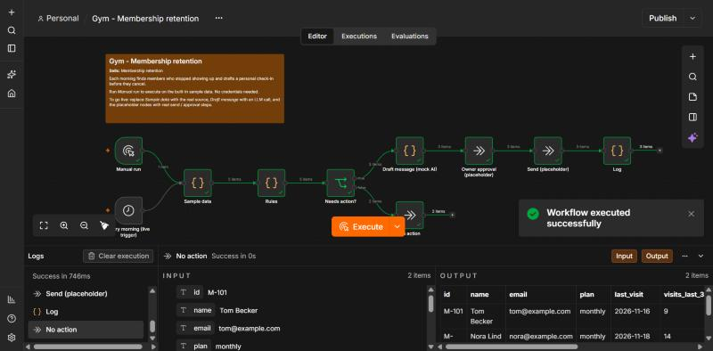

# Gym - Membership retention

**Demo business:** Ironside Fitness (fictional)
**What the business buys:** Membership retention

Each morning finds members who stopped showing up and drafts a personal check-in before they cancel.

**What it replaces:** Finding out a member left only when the payment fails.



## Flow

```mermaid
flowchart LR
  T[Schedule (every morning)] --> S[Sample data]
  M[Manual run] --> S
  S --> R[Rules]
  R --> Q{Needs action?}
  Q -- yes --> D[Draft message] --> A[Owner approval] --> X[Send] --> L[Log]
  Q -- no --> N[No action]
```

## Sample run

5 sample records: 3 produce a draft, 2 are skipped.

| Record | Result |
|---|---|
| M-101 | skipped: active member |
| M-102 | draft: 16 days without a visit |
| M-103 | draft: 34 days without a visit |
| M-104 | skipped: active member |
| M-105 | draft: 21 days without a visit |

Example draft (M-102):

> Hi Aisha, we have not seen you at Ironside for 16 days and wanted to check in. Is there a class or time slot that would suit you better? Just reply to this email. This message was prepared by an automated assistant.

Full output is in `sample-output.json`. Dates in the sample data are generated relative to today, so the result is the same whenever you run it.

## Files

- `workflow.json`: n8n workflow, import and press *Manual run*
- `sample-data.json`: the records used in the demo
- `sample-output.json`: what the run produces
- `screenshot.jpg`: the workflow in n8n after a manual run

## Skeleton, not production

The message is built from a template in a Code node, and approval and sending are placeholder nodes. Going live means swapping in the real data source, an LLM call, a send channel and an approval step.
