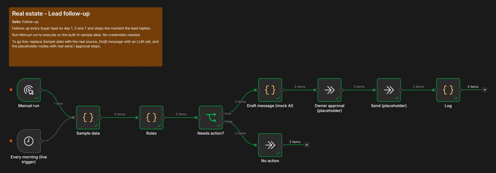

# Real estate - Lead follow-up

**Demo business:** Bayline Realty (fictional)
**What the business buys:** Follow-up

Follows up every buyer lead on day 1, 3 and 7 and stops the moment the lead replies.

**What it replaces:** The follow-up the agent keeps meaning to send.



## Flow

```mermaid
flowchart LR
  T[Schedule (every morning)] --> S[Sample data]
  M[Manual run] --> S
  S --> R[Rules]
  R --> Q{Needs action?}
  Q -- yes --> D[Draft message] --> A[Owner approval] --> X[Send] --> L[Log]
  Q -- no --> N[No action]
```

## Sample run

5 sample records: 3 produce a draft, 2 are skipped.

| Record | Result |
|---|---|
| L-201 | draft: day 1 follow-up due |
| L-202 | draft: day 3 follow-up due |
| L-203 | draft: day 7 follow-up due |
| L-204 | skipped: lead replied, sequence stopped |
| L-205 | skipped: next step not due yet |

Example draft (L-201):

> Hi Grace, thanks for your interest in a 2-bed condo, downtown. I have two listings that match. Would you like the details or a viewing this week? This message was prepared by an automated assistant.

Full output is in `sample-output.json`. Dates in the sample data are generated relative to today, so the result is the same whenever you run it.

## Files

- `workflow.json`: n8n workflow, import and press *Manual run*
- `sample-data.json`: the records used in the demo
- `sample-output.json`: what the run produces
- `screenshot.png`: the workflow in n8n after a manual run

## Skeleton, not production

The message is built from a template in a Code node, and approval and sending are placeholder nodes. Going live means swapping in the real data source, an LLM call, a send channel and an approval step.
