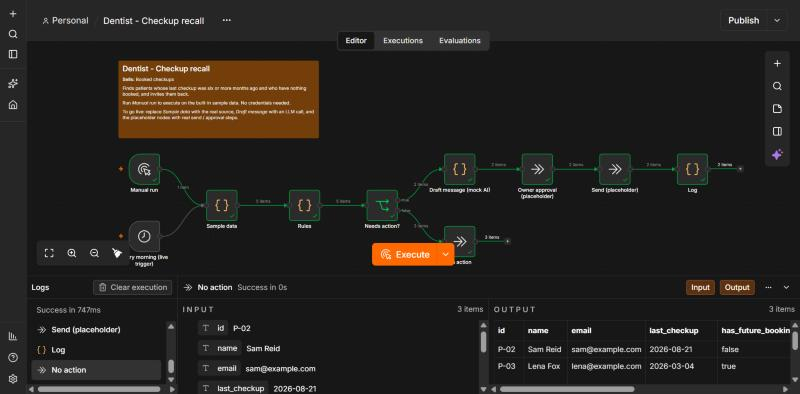

# Dentist - Checkup recall

**Demo business:** Maple Street Dental (fictional)
**What the business buys:** Booked checkups

Finds patients whose last checkup was six or more months ago and who have nothing booked, and invites them back.

**What it replaces:** The recall list nobody at reception has time to call.



## Flow

```mermaid
flowchart LR
  T[Schedule (every morning)] --> S[Sample data]
  M[Manual run] --> S
  S --> R[Rules]
  R --> Q{Needs action?}
  Q -- yes --> D[Draft message] --> A[Owner approval] --> X[Send] --> L[Log]
  Q -- no --> N[No action]
```

## Sample run

5 sample records: 2 produce a draft, 3 are skipped.

| Record | Result |
|---|---|
| P-01 | draft: 6 months since last checkup |
| P-02 | skipped: not due yet |
| P-03 | skipped: already booked |
| P-04 | draft: 13 months since last checkup |
| P-05 | skipped: no consent to be contacted |

Example draft (P-01):

> Hi Olga, it has been 6 months since your last checkup at Maple Street Dental. You can pick a time here: https://example.com/book or reply with a day that suits you. This message was prepared by an automated assistant.

Full output is in `sample-output.json`. Dates in the sample data are generated relative to today, so the result is the same whenever you run it.

## Files

- `workflow.json`: n8n workflow, import and press *Manual run*
- `sample-data.json`: the records used in the demo
- `sample-output.json`: what the run produces
- `screenshot.jpg`: the workflow in n8n after a manual run

## Skeleton, not production

The message is built from a template in a Code node, and approval and sending are placeholder nodes. Going live means swapping in the real data source, an LLM call, a send channel and an approval step.
