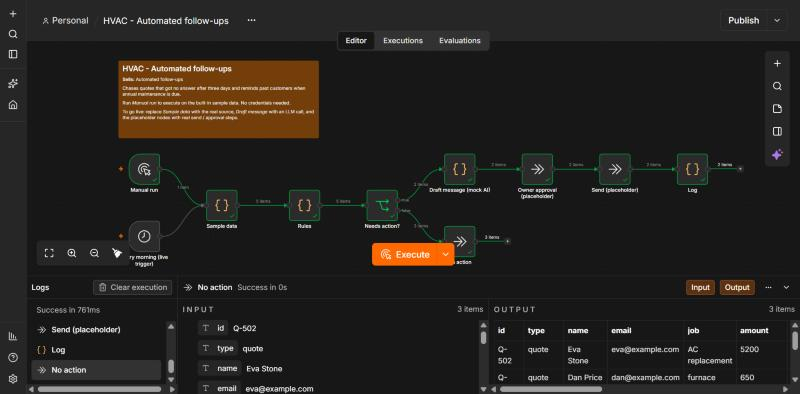

# HVAC - Automated follow-ups

**Demo business:** Northwind Heating & Air (fictional)
**What the business buys:** Automated follow-ups

Chases quotes that got no answer after three days and reminds past customers when annual maintenance is due.

**What it replaces:** Quotes that go cold and service contracts that are never renewed.



## Flow

```mermaid
flowchart LR
  T[Schedule (every morning)] --> S[Sample data]
  M[Manual run] --> S
  S --> R[Rules]
  R --> Q{Needs action?}
  Q -- yes --> D[Draft message] --> A[Owner approval] --> X[Send] --> L[Log]
  Q -- no --> N[No action]
```

## Sample run

5 sample records: 2 produce a draft, 3 are skipped.

| Record | Result |
|---|---|
| Q-501 | draft: quote unanswered for 4 days |
| Q-502 | skipped: quote sent recently |
| Q-503 | skipped: quote accepted |
| S-301 | draft: annual maintenance due |
| S-302 | skipped: serviced recently |

Example draft (Q-501):

> Hi Rob, I wanted to check you received our quote for the heat pump installation. Any questions about the price or timing? Reply here and I will answer the same day. This message was prepared by an automated assistant.

Full output is in `sample-output.json`. Dates in the sample data are generated relative to today, so the result is the same whenever you run it.

## Files

- `workflow.json`: n8n workflow, import and press *Manual run*
- `sample-data.json`: the records used in the demo
- `sample-output.json`: what the run produces
- `screenshot.jpg`: the workflow in n8n after a manual run

## Skeleton, not production

The message is built from a template in a Code node, and approval and sending are placeholder nodes. Going live means swapping in the real data source, an LLM call, a send channel and an approval step.
